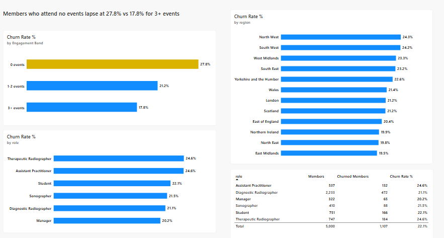
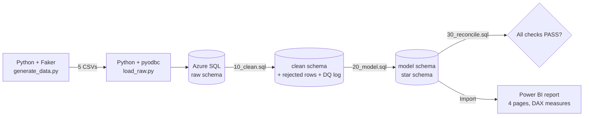
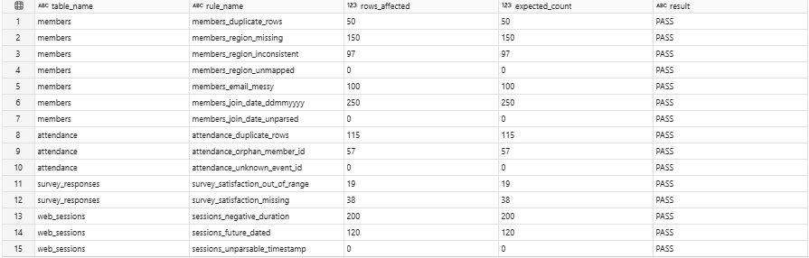
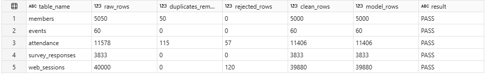
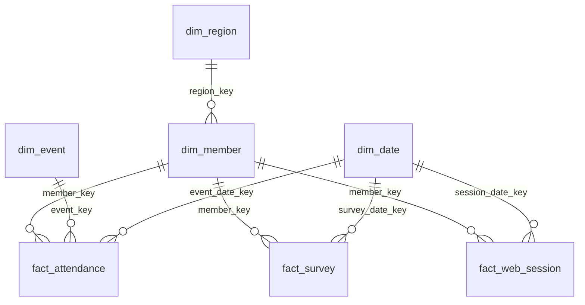
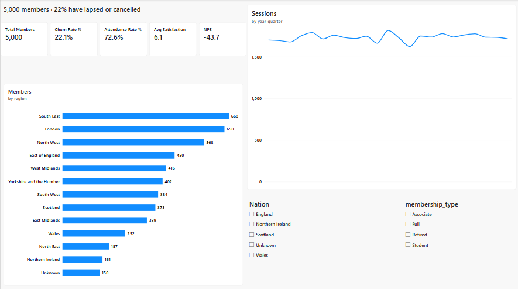
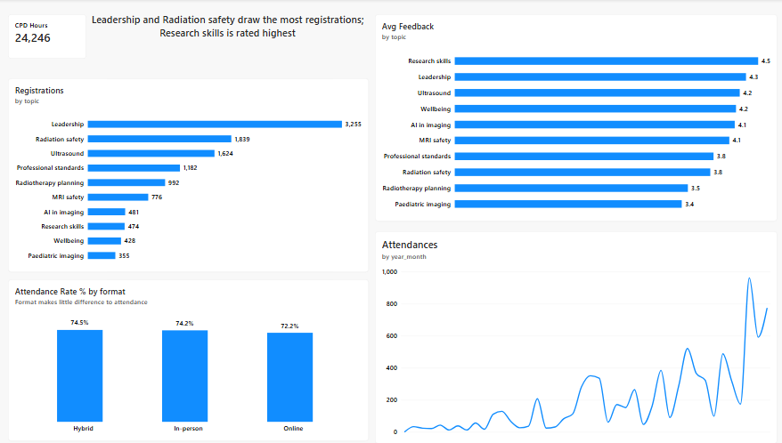
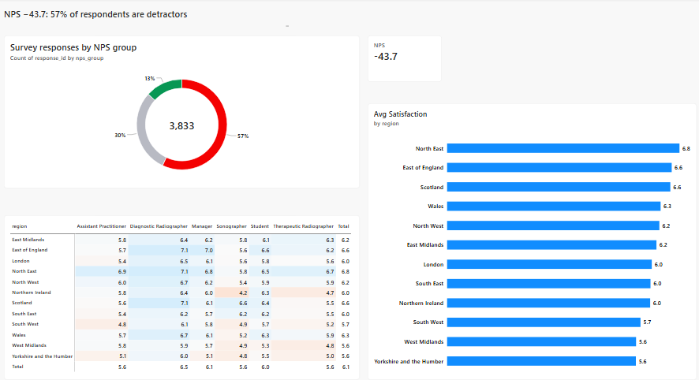

# Membership Insight Pipeline (Azure SQL + Power BI)

An end-to-end analytics project for a professional membership body: synthetic member, CPD event, survey and website data is generated in Python, loaded into **Azure SQL**, cleaned and modelled in **T-SQL**, reconciled with automated data-quality checks, and reported in **Power BI**.

> Personal project built to learn Azure SQL. **All data is synthetic** (Python Faker, `example.com` emails); no real people or organisations are represented.

**Headline findings**
- Members who attend **no events lapse at 27.8%**, against **17.8%** for those attending three or more.
- Net Promoter Score is **−43.7**: 57% of survey respondents are detractors.
- Satisfaction ranges from **6.8/10 (North East)** to **5.6/10 (Yorkshire and the Humber)**.



---

## Questions this project answers
1. Which members are at risk of lapsing?
2. Which CPD events drive engagement?
3. How does survey satisfaction vary by region and role?

## Architecture



| Layer | What it holds | Rule |
|---|---|---|
| `raw` | Data exactly as received, every column as text, tagged with source file and load time | Never edited |
| `clean` | Typed, de-duplicated, standardised data; problem rows moved to `*_rejected` tables with a reason | Every fix is flagged and counted |
| `model` | Star schema for reporting: 4 dimensions, 3 facts | No personal data (names, emails) |

**Tech:** Python (pandas, Faker, pyodbc) · Azure SQL Database (free tier) · T-SQL · Power BI Desktop (DAX) · Git/GitHub

## Data quality

Known problems were deliberately injected into the synthetic data, and the generator recorded how many of each (`data/dq_injected.json`). The T-SQL cleaning layer had to find and fix them, and the pipeline then **reconciles the fix counts against the injected counts automatically**.

**All 15 rules pass, matching the injected counts exactly:**

| Issue | Rows | Action |
|---|---:|---|
| Duplicate member rows | 50 | Removed (one kept per member_id) |
| Missing region | 150 | Set to `Unknown` |
| Inconsistent region (`NW`, `london `, ` SCOTLAND`) | 97 | Standardised to reference list |
| Messy emails (spaces, capitals) | 100 | Trimmed and lower-cased |
| Join dates in dd/mm/yyyy | 250 | Converted to DATE |
| Duplicate attendance rows | 115 | Removed |
| Attendance for non-existent members | 57 | Rejected to `clean.attendance_rejected` |
| Survey satisfaction outside 1–10 | 19 | Set to NULL and flagged |
| Missing satisfaction | 38 | Flagged |
| Negative session duration | 200 | Set to NULL and flagged |
| Sessions dated in the future | 120 | Rejected to `clean.web_sessions_rejected` |
| Safety checks (unmapped region, unparsed date, unknown event, bad timestamp) | 0 | Should always be zero |



**Row counts reconcile through every layer:**



Problem rows are quarantined rather than deleted, so every record can be traced back to its source file.

## Data model



| Table | Grain | Key columns |
|---|---|---|
| `dim_member` | One row per member (+ one `Anonymous` row, key −1, for anonymous web visitors) | role, membership_type, status, join_date, tenure_years, is_churned |
| `dim_event` | One row per CPD event | topic, format (Online / In-person / Hybrid), cpd_hours, capacity |
| `dim_region` | One row per UK region | region, nation |
| `dim_date` | One row per day, 2020–2027 | year, quarter, month, year_month, is_weekend |
| `fact_attendance` | One row per event registration | attended, feedback_score (1–5), cpd_hours_earned |
| `fact_survey` | One row per annual survey response | satisfaction (1–10), likely_to_recommend (0–10), nps_group |
| `fact_web_session` | One row per website session | device, source, pages_viewed, duration_seconds |

## Power BI report

| Page | Shows |
|---|---|
| **Overview** | Members, churn rate, attendance rate, satisfaction and NPS; members by region; sessions over time |
| **Lapse risk** | Churn by event engagement, role and region |
| **CPD engagement** | Registrations and feedback by topic; attendance rate by format; attendance trend |
| **Satisfaction** | NPS breakdown; satisfaction heatmap by region × role |





Key DAX measures: `Churn Rate %`, `Attendance Rate %`, `NPS`, `Avg Satisfaction`, `CPD Hours`, plus calculated columns `Events Attended` and `Engagement Band` on `dim_member`.

## Findings and recommendations

*The data is synthetic, so these show the method rather than real-world conclusions.*

1. **Event engagement is the strongest signal of lapse risk.** Members with no event attendance lapse at 27.8% vs 17.8% for 3+ events, a 1.6× difference. Newer members have had less time to lapse, so the true gap is likely larger.
   **Recommendation:** target members with zero attendance in their first year with a personalised CPD offer before their first renewal.
2. **Popularity and quality don't match across CPD topics.** Leadership draws the most registrations (3,255), but Research skills is rated highest (4.5/5) with only 474 registrations. Paediatric imaging is rated lowest (3.4/5).
   **Recommendation:** promote highly rated, under-attended topics, and review content for the lowest-rated ones. Delivery format makes little difference to attendance (72–75%), so online delivery can be expanded without hurting turnout.
3. **Advocacy is weak and varies by region.** NPS is −43.7, and satisfaction is lowest in Yorkshire and the Humber, the West Midlands and the South West (5.6–5.7).
   **Recommendation:** follow up with detractors in the lowest-scoring regions, and track NPS quarterly against these baselines.

## How to run it

**Prerequisites:** Python 3.11+, ODBC Driver 18 for SQL Server, an Azure SQL database, Power BI Desktop (Windows).

```powershell
git clone https://github.com/Laminf2ray/membership-insight-azure.git
cd membership-insight-azure
python -m pip install faker pandas numpy pyodbc

# 1. Connection details: copy the template and fill it in
copy .env.example .env      # set SQL_SERVER, SQL_DATABASE, SQL_USER, SQL_PASSWORD

# 2. Generate synthetic data (fixed seed, so it's identical on every run)
python src\generate\generate_data.py

# 3. Load CSVs into the raw schema (row counts reconciled)
python src\load\load_raw.py

# 4. Clean, model and reconcile (exits with an error if any check fails)
python src\load\run_sql.py
```

Then open `powerbi/membership-insight.pbix` and refresh. The free-tier database auto-pauses when idle, so the first connection may take a minute while it wakes up.

## Repository structure

```
data/            dq_injected.json (CSVs are regenerated, not committed)
docs/            screenshots used in this README
powerbi/         Power BI report (.pbix)
sql/             10_clean.sql, 20_model.sql, 30_reconcile.sql
src/generate/    generate_data.py: synthetic data with injected DQ issues
src/load/        load_raw.py (CSV → raw), run_sql.py (runs the SQL pipeline)
.env.example     connection settings template (real .env is git-ignored)
```

## Limitations and next steps
- The data is synthetic; the patterns were built into the generator, so the findings demonstrate the method, not real behaviour.
- Loads are full refreshes. A next step is incremental loading and scheduling with Azure Data Factory.
- Lapse risk is descriptive. A next step is a simple churn model (e.g. logistic regression on engagement, tenure and satisfaction).

---

**Author:** Lamin Touray · [GitHub](https://github.com/Laminf2ray) · [Medium](https://medium.com/@laminf2ray)
